# 4-Bit Ripple Carry Adder — Full-Custom 45 nm CMOS

Full-custom design of an XOR gate, a 1-bit full adder and a 4-bit ripple carry adder in the **gpdk045 (45 nm)** process using Cadence Virtuoso. Every block goes from schematic → transient characterization → layout → DRC/LVS → (for the full adder) Quantus parasitic extraction and post-layout timing.

Built on a small custom standard-cell set (INV 1X/2X, NAND2 1X/2X) designed earlier in the course. Schematics, testbenches and layouts are generated and verified with **SKILL scripts** so every result in this README can be regenerated.

| Block | Result |
|---|---|
| XOR (static CMOS, 12T) | Worst-case delay 34.7 ps rise / 37.8 ps fall · DRC clean · LVS match |
| Full adder (P = NAND2_2X, Q = NAND2_1X) | Cin→Cout 36.8 ps (schematic), 69.5 ps (post-layout) · DRC clean · LVS match |
| 4-bit ripple carry adder | All test vectors correct · C0→C4 172.6 ps (≈ 42 ps/stage) · DRC clean · LVS match |

---

## Contents
- [Methodology](#methodology)
- [1. XOR gate](#1-xor-gate)
- [2. Full adder](#2-full-adder)
- [3. Full adder layout and post-layout timing](#3-full-adder-layout-and-post-layout-timing)
- [4. 4-bit ripple carry adder](#4-4-bit-ripple-carry-adder)
- [Takeaways and next steps](#takeaways-and-next-steps)
- [Repository layout](#repository-layout)
- [Reproducing the flow](#reproducing-the-flow)

---

## Methodology

| Parameter | Value |
|---|---|
| Process / models | gpdk045, 45 nm, Spectre section `mc` |
| VDD / temperature | 1.0 V / 27 °C |
| Input edges | 10 ps rise/fall, 1 ns bit period |
| Accuracy | `errpreset = conservative` |
| Delay definition | 50 % input crossing → 50 % output crossing |
| Tools | Virtuoso IC25.1, Spectre, Pegasus (DRC/LVS), Quantus (RC extraction) |

**Realistic timing context.** Every device under test is measured in the same harness: each input is driven by an **INV_1X** (so the DUT sees a real gate-driven edge, not an ideal source), and each output is loaded by an **INV_2X**. Delays are taken at the DUT's own pins, and only one input changes per transition.

| Cell | PMOS W | NMOS W | L |
|---|---|---|---|
| INV 1X / 2X | 240 / 480 nm | 120 / 240 nm | 45 nm |
| NAND2 1X / 2X | 240 / 480 nm each | 240 / 480 nm each | 45 nm |

---

## 1. XOR gate

A 12-transistor complementary CMOS XOR: two INV_1X cells generate `A'` and `B'`, and an 8-transistor core implements two parallel series pairs in each network: the PMOS pull-up pairs are gated by (B, A') and (A, B'), and the NMOS pull-down pairs by (A, B) and (A', B'). The output is pulled low when A = B and high when they differ.

<p align="center">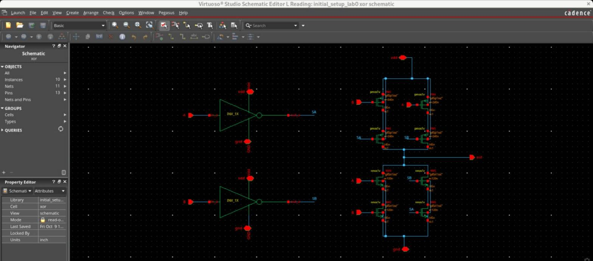</p>

### Sizing sweep
Wider core transistors were **slower** — the gate's own diffusion and gate capacitance grew faster than its drive. Minimum (inverter-matched) sizing was kept.

| Core W (NMOS/PMOS) | tPLH (B) | tPHL (A) | tPLH (A) | tPHL (B) |
|---|---|---|---|---|
| **120 / 240 nm** | **28.07** | **37.79** | **24.99** | **35.16** |
| 240 / 480 nm | 28.91 | 42.59 | 26.14 | 39.17 |
| 480 / 960 nm | 32.24 | 55.63 | 30.06 | 51.91 |

All values in ps. A full sweep of all eight single-input transitions ([`results/xor_delays.csv`](results/xor_delays.csv)) gives worst cases of **34.73 ps rising** and **37.79 ps falling**, both when A switches with B = 0 — that edge must pass through an input inverter before reaching the core.

<p align="center">
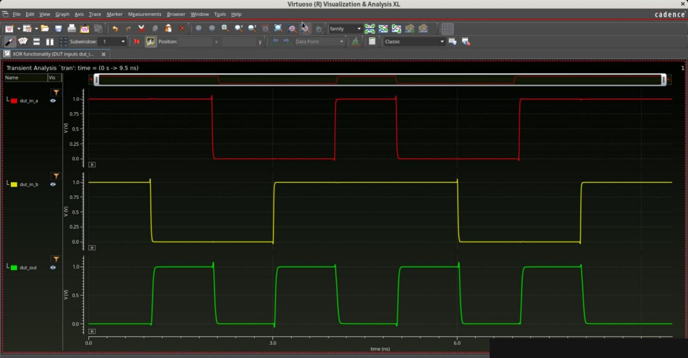
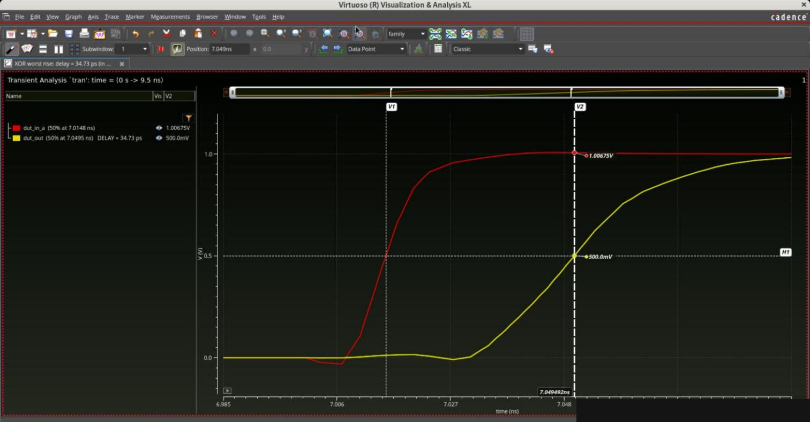
</p>

### Layout
Transistors stand upright in four columns (B, A', B', A) so each poly strip is the shared gate of one PMOS and one NMOS. Local wiring is on Metal1; the long horizontal nets (A, B, A', B') run on Metal2 so they cross the Metal1 without shorting.

<p align="center">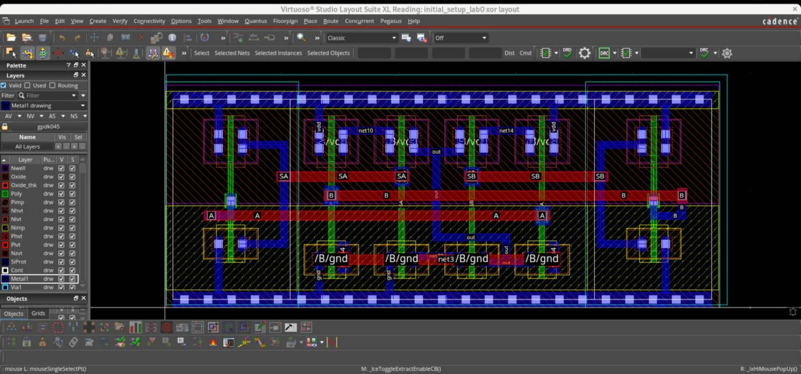</p>

---

## 2. Full adder

`S = A ⊕ B ⊕ Cin` uses two XORs. The carry is built from NAND2 gates:

```
P    = NAND(Cin, A⊕B)          ← "Gate P"
GN   = NAND2_1X(A, B)
Cout = NAND(P, GN)             ← "Gate Q"   = A·B + Cin·(A⊕B)
```

<p align="center">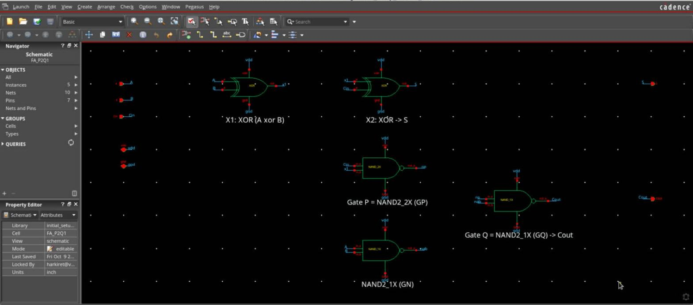</p>

### Gate sizing study (carry path)
Measured with (A, B) = (0, 1) while Cin toggles, so the edge travels Cin → P → Q → Cout.

| Gate P | Gate Q | Cout tPLH | Cout tPHL | **Cout avg** | Sum avg |
|---|---|---|---|---|---|
| **NAND2_2X** | **NAND2_1X** | 35.78 | 37.85 | **36.82** | 40.63 |
| NAND2_1X | NAND2_2X | 41.07 | 39.95 | 40.51 | 37.16 |
| NAND2_2X | NAND2_2X | 37.30 | 38.52 | 37.91 | 40.27 |
| *Alternative: 5 × NAND2_1X + INV* | | 40.22 | 42.78 | 41.50 | 38.76 |

**Strong P, weak Q wins**: a 2X Gate P drives the internal node fast, while a 1X Gate Q keeps the load on that node small. Upsizing Q doubles the capacitance P must charge, which costs more than Q's extra drive saves. The chosen design is **11 % faster** on carry than the NAND/INV-only alternative ([schematic](docs/img/fa_nand_inv_schematic.jpg)) and uses fewer transistors.

<p align="center">
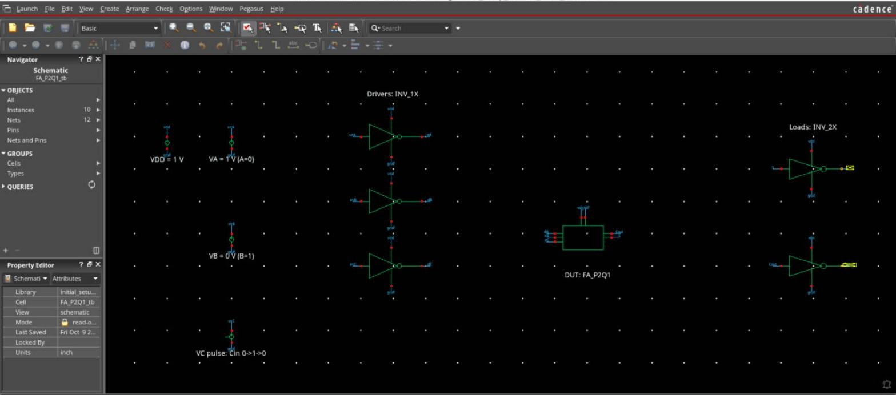
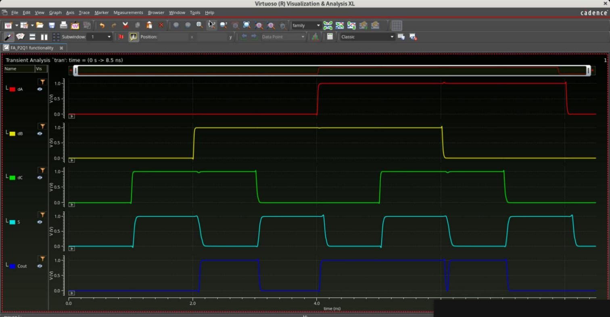
</p>

All eight input combinations produce the correct S and Cout. The brief dip on Cout near 6 ns (B falls with A = Cin = 1) is a hazard from unequal path delays: the A·B path turns off just before the Cin·(A⊕B) path turns on.

---

## 3. Full adder layout and post-layout timing

The full adder is a single 17.2 µm row built from the verified cells (XOR, XOR, Gate P, Gate Q, GN) on shared rails. Inter-cell routing follows one rule that makes shorts impossible by construction: **every pin rises on its own vertical Metal3 riser, and every net runs on its own horizontal Metal4 track**.

<p align="center">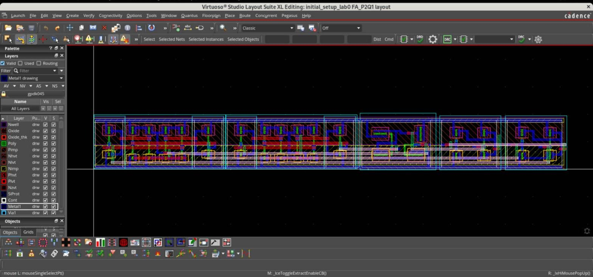</p>

<p align="center">
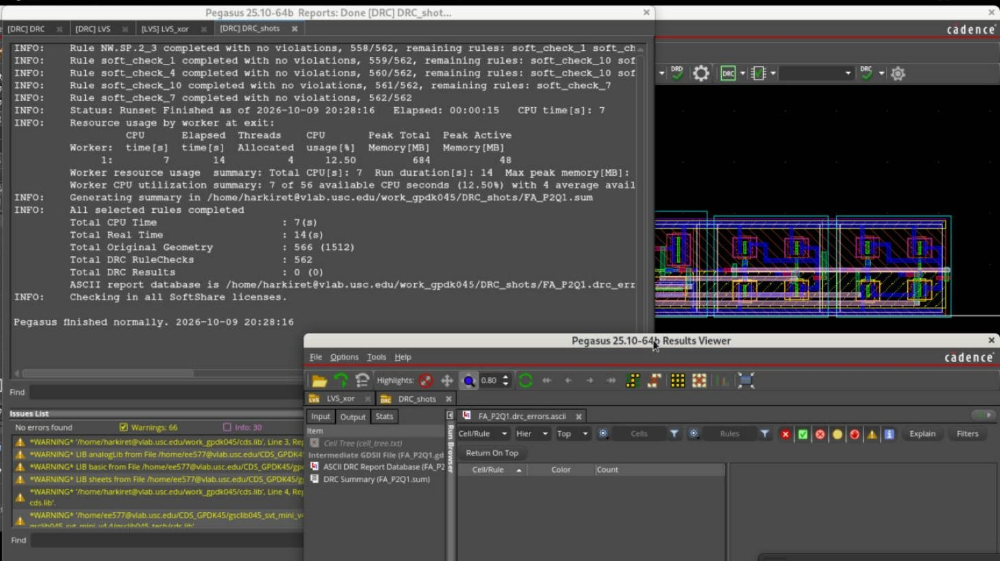
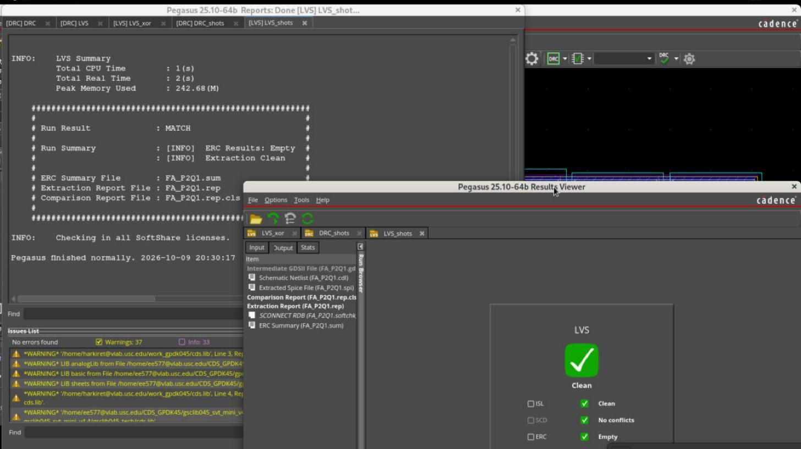
</p>

The layout was extracted with **Quantus** (RC-coupled, typical) and re-simulated with a config view that binds *only* the DUT to `av_extracted`, leaving drivers and loads as schematics.

| Path | Schematic avg | Post-layout avg | Increase |
|---|---|---|---|
| Cin → Cout | 36.82 ps | **69.52 ps** | +89 % |
| Cin → Sum | 40.63 ps | **66.03 ps** | +63 % |

<p align="center">
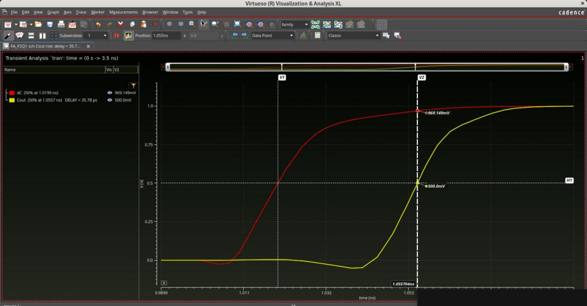
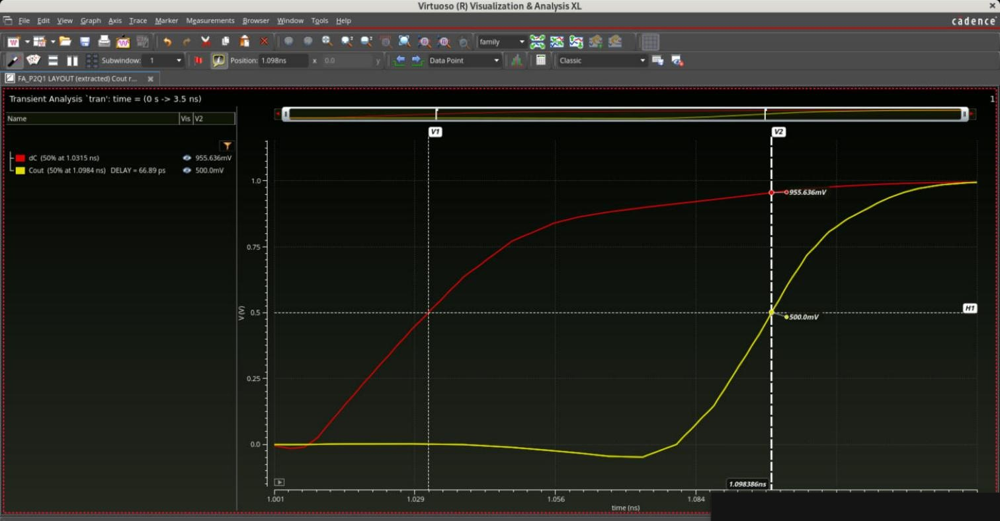
<br><em>Cin → Cout rising edge: schematic 35.8 ps (left) vs extracted layout 66.9 ps (right).</em>
</p>

Wire capacitance on the multi-micron Metal3/Metal4 routes is comparable to the gate capacitance of these near-minimum devices, so the carry path nearly doubles. See [next steps](#takeaways-and-next-steps) for how to recover it.

---

## 4. 4-bit ripple carry adder

Four instances of the full adder, carry chained C0 → C1 → C2 → C3 → C4.

<p align="center">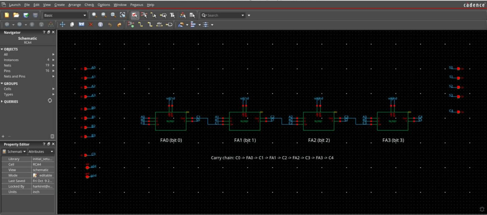</p>

### Functionality
| A | B | C0 | Expected | Simulated (C4 S3..S0) |
|---|---|---|---|---|
| 15 | 15 | 1 | 31 | 1 1111 ✔ |
| 14 | 1 | 0 | 15 | 0 1111 ✔ |
| 12 | 3 | 1 | 16 | 1 0000 ✔ |

<p align="center">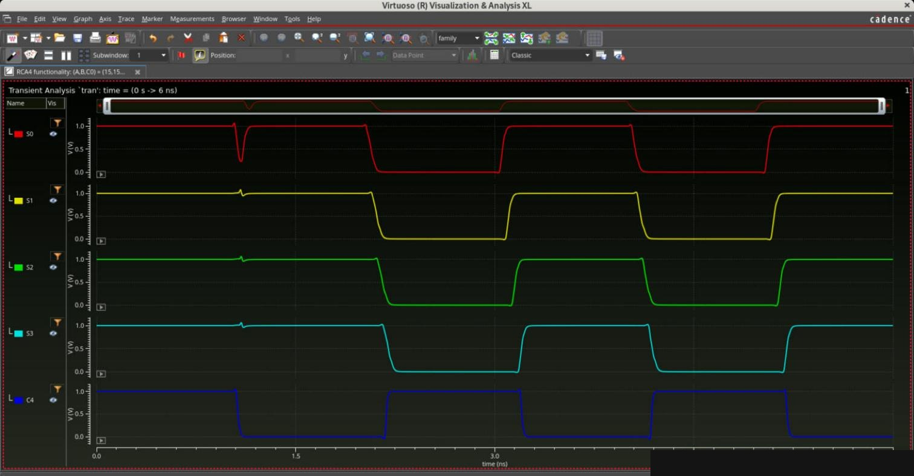</p>

### Carry-chain delay
With **A = 1111, B = 0000** every stage propagates (Ai ⊕ Bi = 1). Toggling C0 drives (C4, C3, C2, C1) from 0000 → 1111 and S3 from 1 → 0.

| Path | tPLH | tPHL | Average |
|---|---|---|---|
| C0 → C4 | 164.21 ps | 180.93 ps | **172.6 ps** |
| C0 → S3 | 178.20 ps | 167.99 ps | **173.1 ps** |

The carry arrives at C1, C2, C3 at +41, +84, +127 ps — about **42 ps per stage**, slightly more than a lone full adder (36.8 ps) because inside the chain each carry drives the next stage's XOR and NAND2_2X inputs and arrives with a slower edge.

<p align="center">
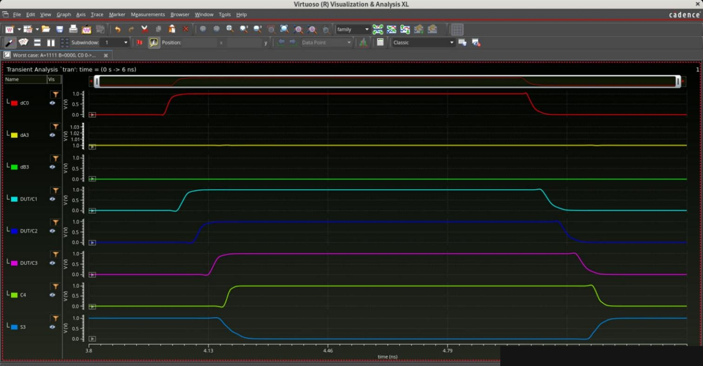
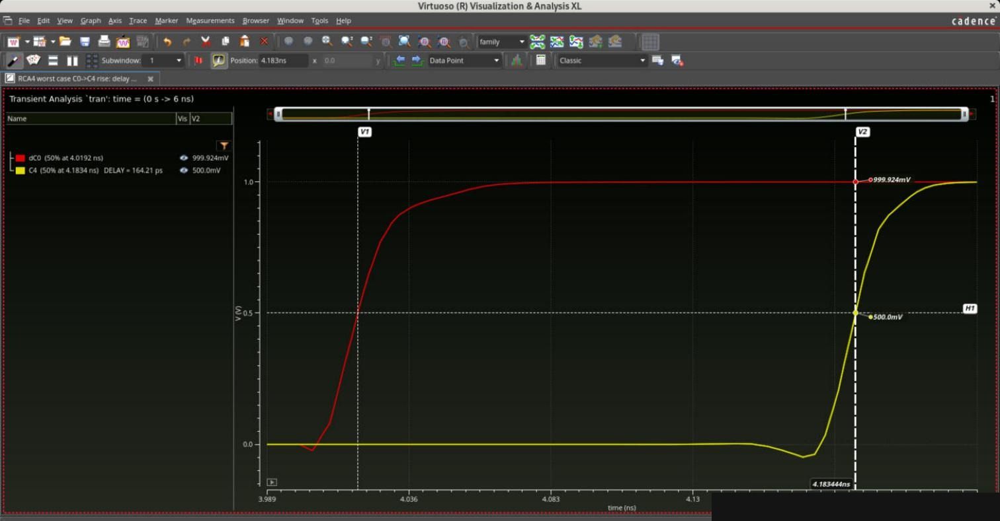
</p>

### Layout
Four full-adder rows stacked, with rows 2 and 4 mirrored so neighbouring rows share a VDD or GND rail. Each carry-out hops up to the next row's carry-in on a short Metal3/Metal4 jog; Metal1 straps tie the GND rails on the left and the VDD rails on the right.

<p align="center">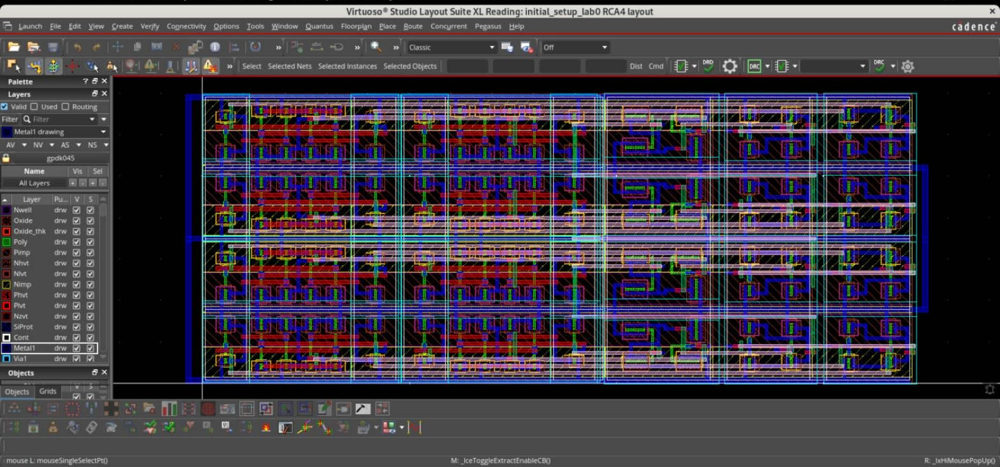</p>

<p align="center">
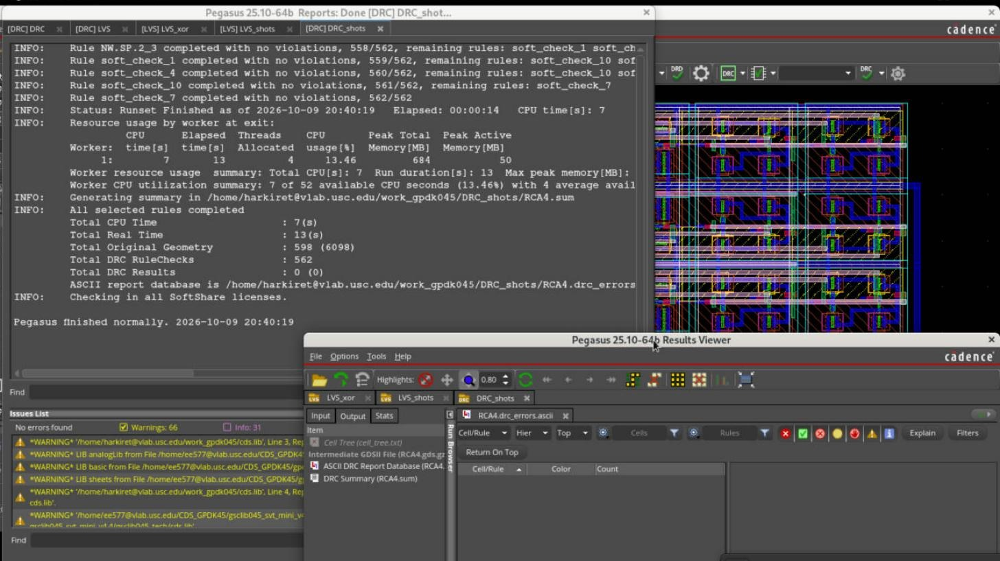
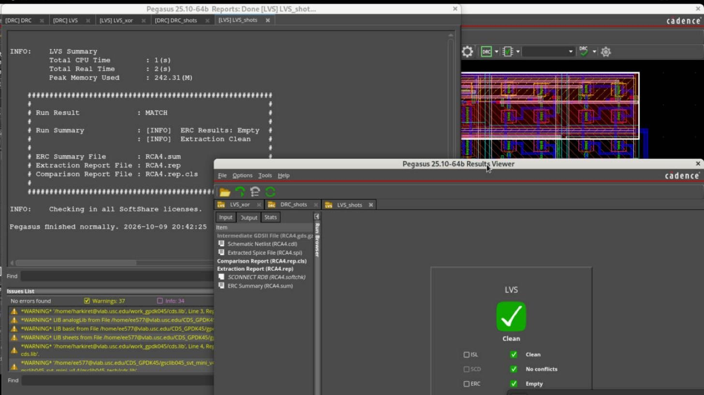
</p>

---

## Takeaways and next steps

**What I learned**
- **Bigger isn't faster** when a gate mostly drives its own parasitics — both the XOR sweep and the Gate Q result show this.
- **Size for the critical path, not per cell**: the best full adder pairs a strong driver with a light load on the carry node.
- **Layout dominates at 45 nm**: wiring added ~33 ps to the carry path, more than the entire difference between gate-sizing options.
- **Verify the sizes, not just the topology**: LVS here did not compare widths, and a mismatched PMOS width in an inherited inverter layout was caught only by comparing device parameters directly.

**Known limitations / next steps**
- **Placement for the carry path.** Placing Gate P, Gate Q and the Cin pin adjacent, and keeping short nets (Cin, P) on Metal2 instead of climbing to Metal4, should cut post-layout carry delay substantially.
- **Diffusion sharing / fingering** in the base cells would reduce junction capacitance on internal nodes.
- **True worst case.** The C0 edge is the standard carry-chain test; an A0 edge with C0 = 1 adds the first-stage XOR to the path and is slower. A full sweep of bit-0 transitions would pin down the real critical path.
- **Architecture comparison.** Extend to 8/16 bits and compare against carry-lookahead or Kogge-Stone adders for delay, area and energy.

---

## Repository layout

```
docs/img/                 Schematic, waveform, layout and DRC/LVS screenshots
results/                  Measured delays (CSV)
skill/
  config.il               Library name, work dir, model path  ← edit first
  schematic/              Generate FA variants, testbenches, RCA4 (+ OCEAN sims)
  layout/                 XOR, full adder and RCA4 layout generators
  sim/                    XOR / FA simulations, delay plots, post-layout config view
  util/                   Schematic annotation, plotting, terminal→Virtuoso command poller
scripts/
  drc.sh  lvs.sh  qrc.sh  Batch Pegasus DRC/LVS and Quantus extraction per cell
  drc_summary.sh          Readable DRC error list (DBU → µm)
  hrrun.sh                Pipe SKILL from a shell into a running Virtuoso
```

The gpdk045 PDK and Cadence libraries are licensed and **not included**.

## Reproducing the flow

1. Create the base cells (INV, INV_2X, NAND_1X, NAND_2X, xor schematic/symbol) in your library.
2. In the Virtuoso CIW:
   ```lisp
   load("skill/config.il")
   load("skill/schematic/gen_schematics.il")
   hrFA_a("FA_P2Q1" "NAND_2X" "NAND_1X")  hrFA_tb("FA_P2Q1_tb" "FA_P2Q1")
   hrSimFA("FA_P2Q1_tb" "schematic")      ; prints Cout/Sum tPLH, tPHL, average
   load("skill/layout/fa_layout.il")      ; full adder layout
   load("skill/layout/rca4_layout.il")    ; RCA4 layout (after fa_layout.il)
   ```
3. From a shell: `scripts/drc.sh FA_P2Q1 && scripts/lvs.sh FA_P2Q1 && scripts/qrc.sh FA_P2Q1`
4. Post-layout: `load("skill/sim/postlayout_config.il")  hrMakeExtractedConfig("FA_P2Q1_tb")  hrSimFA("FA_P2Q1_tb" "config")`

The batch DRC/LVS/QRC scripts reuse the control files that the Pegasus/Quantus GUIs write for one reference cell; point `DRC_REF`, `LVS_REF` and `QRC_REF` at your own run directories.

---

*Course project for EE 477 (MOS VLSI Circuit Design), University of Southern California. SKILL automation and documentation were developed with AI assistance (Claude); design decisions and results were reviewed by the author.*
